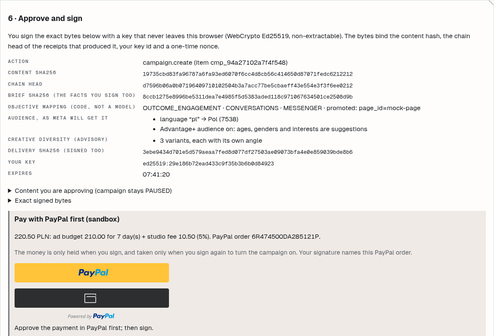
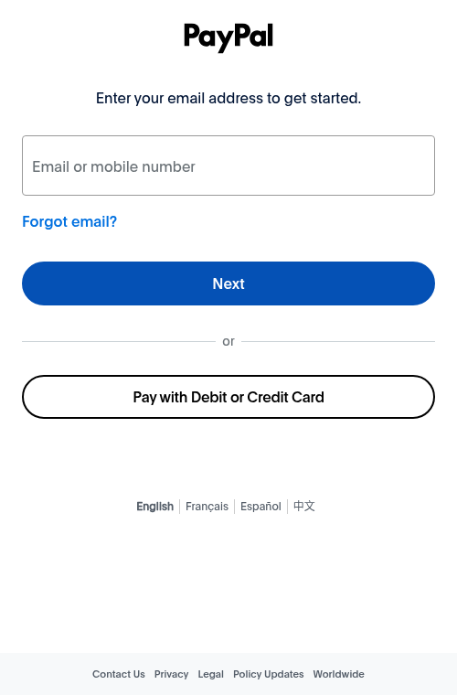
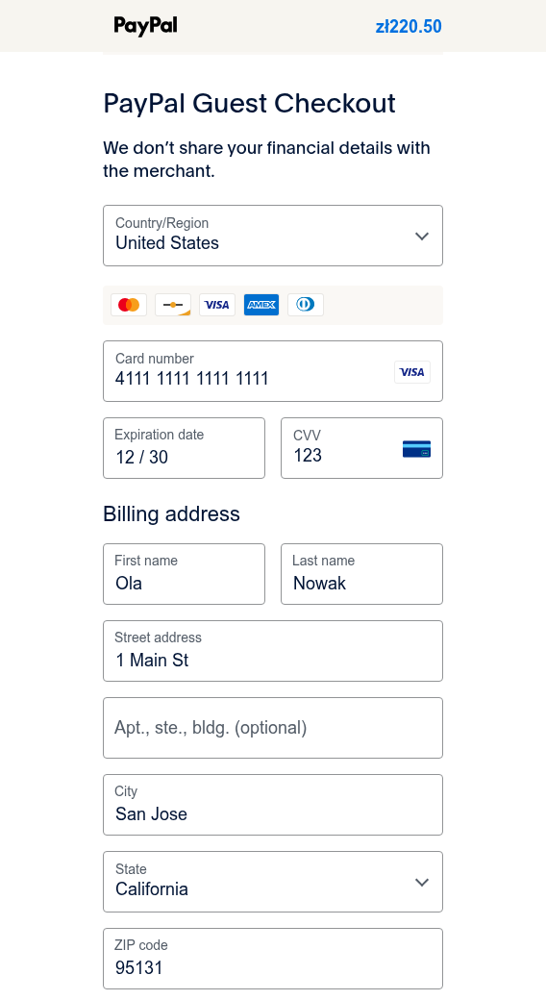
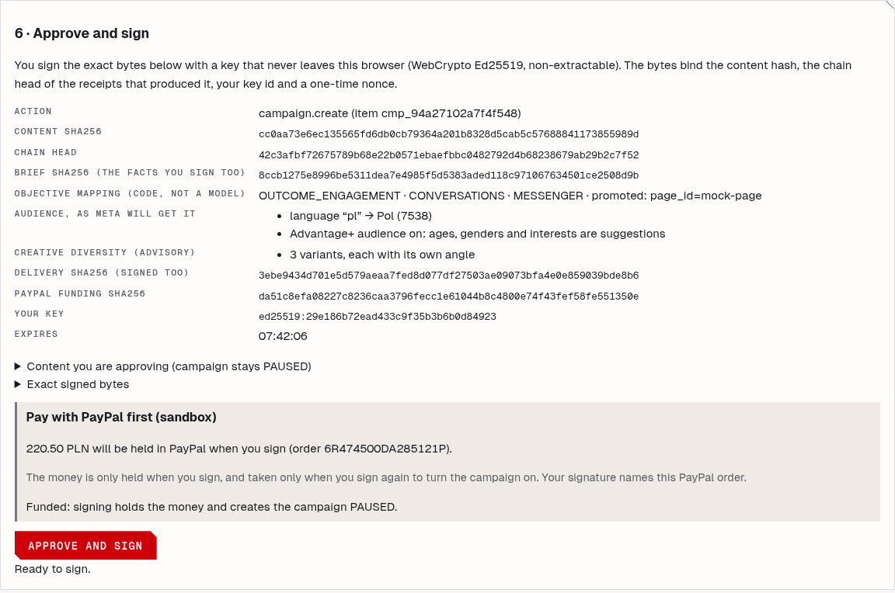
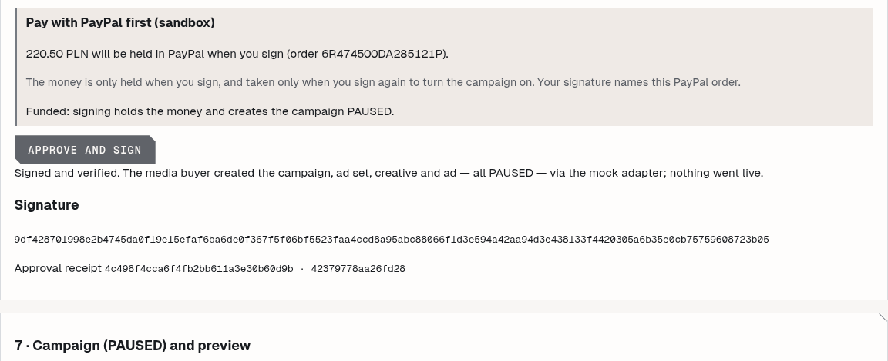
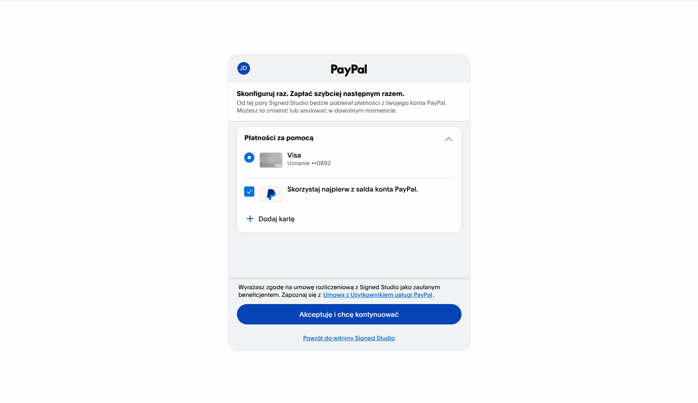
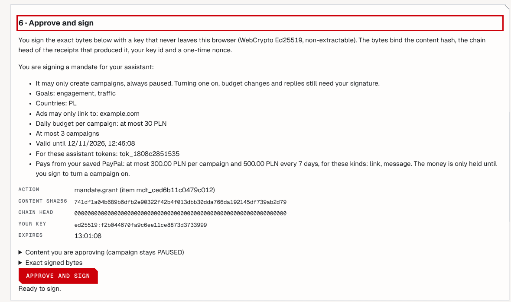
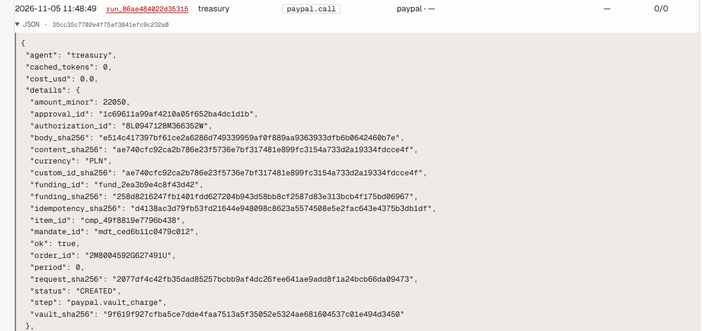

# Signed Studio

**An AI ad agency for one-person businesses that cannot spend a cent you did not sign for.**

AI agents plan, write, draw and review an ad. **PayPal holds the budget, your signature
releases it, and PayPal's own signed webhooks prove it.** Your own AI assistant can also pay
for a campaign from your saved PayPal, but only within a spending mandate you signed. Then
`studio verify` checks the whole money trail offline, against what you signed and not
against what the server says.

Built for the **PayPal AI Hackathon 2026**. Everything PayPal-related was written from 3 Nov 2026 (see
[What was built during the submission period](#what-was-built-during-the-submission-period)).
**PayPal sandbox only**: any `PAYPAL_ENV` other than `sandbox` stops the app at start.

## Judges: the 5-minute path

- Live demo: **https://pay.udun.eu** (login `judge`; the password and the PayPal **sandbox
  buyer** login are in the submission form, not in this repository).
- No login: https://pay.udun.eu/try replays a recorded run and verifies its receipts in your
  browser.

**1. Pay and sign (buyer present)**

1. Open **Studio** and press "or use an example brief instead", then **Draft my brief**.
   Answer or strike the questions and press **Confirm the brief and run the studio**.
2. At "Approve and sign" the studio has already computed the amount from the signed payload
   (daily budget × days + a 5 % fee). Click the **PayPal** button, log in as the sandbox
   buyer and approve the order.
3. Press **Approve and sign**. Your browser signs the ad's bytes *and* the PayPal order
   (`funding/v1`). The campaign is created **PAUSED**, and only then is the order
   authorized. The money is held, not taken.
4. **Activate** the campaign and sign again. The capture runs first: no capture, no
   activation.

**2. Let your assistant pay under a mandate (buyer not present)**

1. `/account` → Assistants & API → make a token. (Assistant tokens are off for the shared
   `judge` account. Sign up with your own account, or watch it in the video.)
2. **Save my PayPal**: approve it once in PayPal as the sandbox buyer (Vault v3).
3. **Mandates**: tick "Let the assistant pay from my saved PayPal", set the caps (for
   example 300 per campaign, 500 per 7 days) and sign. The signing screen lists every
   limit in words.
4. From any MCP client or curl, call `run_brief`. The answer is either
   `outcome: mandate_charge` with the charge's receipt, or `outcome: pay_and_sign` with the
   reasons (`max_charge`, `funding_cap`, `kind`, `revoked`, …) and a link for you.

**3. Check it**

Export the receipts (footer link) and run:

```bash
studio verify receipts.jsonl --server https://pay.udun.eu
```

Change one byte and it fails with exit 2, naming the receipt.

`--server` is **trust on first use (TOFU)**: it trusts the key and manifest `seq` the
server serves at that moment. For a real check, pin the ledger key once, out of band
(`--key-file ledger.pub`), and pass the highest `seq` you have seen as `--min-seq`, so a
rollback to an older log cannot go unnoticed. Offline:
`studio verify receipts.jsonl --key-file ledger.pub --approver-keys approvers.json --min-seq <seq>`.
`studio verify --paypal-events … --paypal-certs … --paypal-webhook-id …` also re-checks
PayPal's RSA signature of every exported webhook.

| Result (from [docs/eval.md](docs/eval.md)) | Value |
|---|---|
| `studio verify` on tampered exports | **600/600 rejected** (24 classes × 25) |
| `studio verify` on clean exports | 25/25 accepted |
| Attack suites, including **12 PayPal money attack classes** | **284/284 pass** (25 files) |
| Webhook signatures | RSA `SHA256withRSA` verified offline, cert chain completed from a pinned DigiCert intermediate |
| Cost of one campaign run (brief → approval) | $0.0945 (`demo` brief) |

## Screens: one payment, end to end

Recorded on 5 Nov 2026 against the **real PayPal sandbox** (`PAYPAL_ADAPTER=rest`). The
models ran on recorded answers and the ad platform was mocked. The buyer paid with
PayPal's public sandbox test card in guest checkout. PayPal's record of this run reads:
order `6R474500DA285121P`, payer approved, authorization `CREATED`, then capture
`COMPLETED` for 220.50 PLN after the activation signature. `studio verify` on the export
printed `chain OK, 287 receipts, 5 signatures valid`.

**1. The approval screen computes the amount and creates the PayPal order.** The order's
`custom_id` is the ad's `content_sha256`. Signing stays disabled until PayPal reports that
the payer approved.



**2. The buyer approves in PayPal** (sandbox checkout, the amount PayPal shows is the one
code computed):

 

**3. Funded: the signature now covers the PayPal order too.** A new row,
`PAYPAL FUNDING SHA256`, joins the hashes being signed.



**4. Signed: the campaign is created PAUSED, then the money is held** (authorization, not
capture). Turning it on is a second signature, and that one captures.



## Screens: the assistant pays under a mandate

Same day, same setup, buyer not present. The owner saved PayPal once (Vault v3, as the
sandbox Personal buyer), signed a mandate, and an assistant token ran a brief over the API.
`run_brief` answered `outcome: mandate_charge`: order `2M8004592G627491U`, authorization
`8L094712BM366352W` for 220.50 PLN, campaign PAUSED. `studio verify` on the export printed
`chain OK, 342 receipts, 6 signatures valid`.

**5. Save PayPal once.** PayPal asks the buyer to agree to a billing agreement with the
studio. (The sandbox buyer's account country is Poland, so PayPal shows this page in Polish.)



**6. Sign the limits.** The signing screen lists every limit in words before the hashes:
goals, countries, hosts, daily budget, number of campaigns, expiry, which tokens, and the
PayPal caps (per campaign and per period). The signed body carries the `mandate-funding/v1`
block with the saved PayPal's SHA-256, never its id.



**7. The assistant's charge, as a receipt.** `paypal.vault_charge` names the mandate and
the approval that allowed it, the amount, the PayPal order and authorization, and hashes of
the request and response. P-V5 re-checks it offline: the charge was declared by a valid
mandate, fits both caps, and appears once in the whole log.



## Why this is different

Most "human in the loop" payments are a button. Here the approval is cryptographic, bound to
money, and anyone can check it:

- **The signature covers the money.** The browser holds a non-extractable WebCrypto Ed25519
  key. "Approve" signs the ad's `content_sha256`, the provenance chain that produced it, and
  `funding_sha256`: the PayPal order id, amount, currency and payee. The PayPal order's
  `custom_id` is the ad's hash, so PayPal's own record names the exact bytes you signed.
- **No model touches money.** No model has PayPal credentials or a PayPal write tool. Money
  moves only through code that checks an owner signature or a mandate the owner signed.
- **Mandates, like AP2's intent mandates.** You sign the limits once. Each charge is
  declared in the approval receipt (`charge/v1`) and reserved against the period cap in one
  database transaction *before* PayPal is called. Charges still in flight count, so two
  parallel runs cannot both slip under the cap.
- **Exactly-once money.** Every POST carries a `PayPal-Request-Id` derived from what
  authorises the step. A retry, a restart or a double click cannot move money twice. An
  ambiguous outcome (timeout, 5xx) stays reserved until the same request id settles it.
- **The server is not trusted.** It holds the ledger key and could re-sign an edited log, so
  `studio verify` checks the log against what the *owner* signed:

| Rule | Checks |
|---|---|
| P-V1 | a capture rides on a signed activation of a campaign whose creation signed this order, or that a mandate charge funded |
| P-V2 | captured ≤ authorized ≤ signed, same currency |
| P-V3 | each webhook is RSA-verified, re-read from PayPal's API, for an order this run funded, `custom_id` = the signed ad |
| P-V4 | a refund matches its signed `refund/v1` body and never exceeds the capture |
| P-V5 | a vault charge was declared by a valid mandate approval, stays within `max_charge_minor` and the period's `funding_cap_minor`, is charged once in the whole log, and is voided if recorded after revocation |
| P-V6 | every PayPal money step names a valid approval of the right action, used once |

The 12 attack classes, each refused at run time and caught offline: an amount edited after
signing, an order id swapped, a capture without activation, a capture above the
authorization, a refund without approval or done twice, a forged webhook signature, a
replayed or stale webhook, a webhook for an unknown order, a `custom_id` mismatch, a charge
over the mandate's caps, a charge after revocation, and a charge replayed against another
mandate (`tests/attack/test_paypal_money.py`, `tests/attack/test_paypal_vault.py`).

## PayPal APIs used

| API | Calls | Where |
|---|---|---|
| OAuth 2.0 | `POST /v1/oauth2/token` (client credentials, cached) | `studio/paypal/client.py` |
| Orders v2 | `POST /v2/checkout/orders` (`AUTHORIZE`; with `vault_id` for mandate charges), `GET`, `POST …/authorize` | `studio/paypal/orders.py` |
| Payments v2 | capture, void, reauthorize, refund, and `GET` of each | `studio/paypal/orders.py`, `money.py` |
| Vault v3 | setup tokens, payment tokens, `DELETE` of a saved PayPal | `studio/paypal/vault.py` |
| Webhooks | `POST /webhooks/paypal`: RSA over `transmission_id\|time\|webhook_id\|crc32(body)`, cert chain and host checked, cert pinned by SHA-256 | `studio/paypal/webhooks.py` |
| Transaction Search | `GET /v1/reporting/transactions` (read; reconciliation) | `studio/paypal/reconcile.py` |
| Disputes (read) | `GET /v1/customer/disputes`, `…/{id}` through the Agent Toolkit | `studio/paypal/agent_tools.py` |
| JS SDK | v5 `paypal.Buttons` (`intent=authorize`) on the approval screen | `studio/ui/static/paypal.js` |

The full money flow, step by step, with the failure paths: **[PAYPAL.md](PAYPAL.md)**.

## Agentic commerce, the PayPal way

PayPal's Agent Ready gives an agent a delegated token with a maximum amount, a currency and
an expiry. Agent Ready and Store Sync are gated (business review), so we built the same
pattern on public APIs: **Orders v2 + Vault v3**. The owner signs a *spending mandate*
(`max_charge_minor`, currency, `funding_cap_minor` per period, expiry, which tokens) and
the studio refuses any charge outside it; the signature is Ed25519 and `studio verify`
re-checks it offline (P-V5), which a bearer token cannot offer.

Around that, on PayPal's own tooling:

- **PayPal Agent Toolkit** (vendored `paypal_agent_toolkit/shared` 1.11.0, Apache-2.0):
  four read tools (`list_transactions`, `get_order_details`, `list_disputes`,
  `get_dispute`) restricted to the account's own PayPal ids, payer data stripped, one
  keyed-hash receipt per call (`studio/paypal/agent_tools.py`).
- **Our MCP server, one rule:** anything that moves money goes through ours (`/mcp`). An
  owner can optionally add PayPal's `https://mcp.sandbox.paypal.com` for read-only
  questions (untested by us, not used by the studio; [docs/assistants.md](docs/assistants.md)).
  The assistant can reconcile (`paypal_transactions`) and `propose_refund`; the proposal is a
  pending approval with a link, the owner signs, and nothing moves before that.
- **Negative testing:** on a capture, the sandbox `PayPal-Mock-Response`
  (`TRANSACTION_REFUSED`) is sent when the owner ticks "simulate PayPal refusing the capture"
  at activation (the sandbox answers `INSTRUMENT_DECLINED` on an authorization capture with an
  empty 403, so the toggle uses the code it really answers, 422 with a `debug_id`). The studio shows PayPal's reason and keeps the money
  held; after a declined authorize the owner funds the campaign again with another PayPal method by running the brief again (a new campaign approval, since the declined one is consumed).
- **Money page** (`/money`, AG Grid Community): holds, captures, voids and mandate charges
  with receipts, "Check with PayPal" (Transaction Search reconciliation) and "Explain"
  by the AI treasurer.
- **Postman:** [docs/postman/](docs/postman/signed-studio.postman_collection.json) (the
  assistant API and the PayPal sandbox calls; `make postman`).

Built with PayPal's help: `/paypal:doctor` (PayPal AI Toolkit plugin for Claude Code) was run
on this repo on 5 Nov 2026 (0 critical, 4 warnings, all fixed) and the APIMatic Context
Plugin for PayPal was installed in the coding agent ([docs/BUILD-LOG.md](docs/BUILD-LOG.md)).

## AI, and where it stops

| Agent | Model | Does | Never |
|---|---|---|---|
| Producer, Copywriter, Art director, Reviewers | Muse Spark 1.3 (+ contributor tier), Muse Image, SAM 3.1, Muse Voice | brief → plan → three copy variants → images → two independent policy reviews | create or fund anything |
| **Treasurer** (`studio/agents/treasurer.py`) | Muse Spark 1.3, strict JSON, no tools | proposes how to split a budget across campaigns and explains a funding's reconciliation in plain words | see a PayPal id, credential or vault reference; move money. Code recomputes every amount it states and replaces a wrong one |
| Media buyer | **code** | creates the campaign PAUSED, only on a consumed approval | run without a signature |

Exact model ids from the code:

| Model id | Where |
|---|---|
| `muse-spark-1.3` | producer, reviewer (vision), treasurer, community, lead scorer, analyst |
| `muse-spark-1.3-contributor` | copywriter and image prompts, only when the input has no personal data (`studio/pii.py`) |
| `muse-image-1.0` | the three placements (`studio/muse/image.py`) |
| `sam-3.1` | product cut-out and a fidelity check of every image: streamed transport, batch parse (`studio/muse/sam.py`) |
| `muse-voice-transcribe-1.0` | spoken brief (`studio/muse/voice.py`) |
| `muse-wonder-1.0` | optional video shot list (`studio/agents/video.py`) |
| `meta-models/muse-spark-open` | second-opinion reviewer, open weights on Baseten (`studio/muse/openweights.py`) |

Review rules and platform limits: [docs/policy.md](docs/policy.md).

Your own assistant connects over MCP (`claude mcp add --transport http muse
https://pay.udun.eu/mcp --header "Authorization: Bearer …"`) or the HTTPS API
(`/api/v1/openapi.json`). It can draft and run; it pays only inside a signed mandate, and
turning a campaign on always needs your signature ([docs/assistants.md](docs/assistants.md),
[docs/mandates.md](docs/mandates.md)).

## Run it locally

```bash
make install       # Python 3.12+, uv
make test          # the whole suite offline, PayPal mocked
make demo          # UI at http://localhost:8000/studio
```

With `PAYPAL_ADAPTER=mock` a fake PayPal plays the buyer, so every flow runs without a PayPal
account. For the real sandbox set `PAYPAL_ADAPTER=rest` and your sandbox app's
`PAYPAL_CLIENT_ID` / `PAYPAL_CLIENT_SECRET` (with Vault enabled). `make eval` regenerates
[docs/eval.md](docs/eval.md). Deployment: [deploy/PAY-DEPLOY.md](deploy/PAY-DEPLOY.md).

## What was built during the submission period

The base (agents, Ed25519 signed approvals, the hash-chained receipt ledger, PAUSED-only
campaign creation, assistant mandates) was written from 27 Oct 2026 for a different
hackathon. Its last commit is tagged **`base-meta-final`** (`8d5f854`, 3 Nov 2026 13:10 CET).
Everything PayPal came after that tag:

- the PayPal client; Orders v2 authorize, capture, void and refund;
- the signed `funding/v1` block in the owner's approval;
- webhooks verified offline and re-read from PayPal's API;
- Vault v3 and customer-not-present charges under a signed spending mandate;
- the `studio verify` rules P-V1 to P-V6 and the 12 attack classes;
- the AI treasurer;
- PayPal Agent Toolkit read tools, reconciliation, refund proposals, sandbox negative
  testing, the AG Grid money page and the Postman collection (5 Nov 2026);
- the removal of the base's Stripe billing.

```bash
git log --format='%ad %s' --date=iso base-meta-final..main
git diff --stat base-meta-final..main | tail -1
```

Day by day: [docs/BUILD-LOG.md](docs/BUILD-LOG.md).

## Honest status

- **PayPal is real (sandbox), the ad platform is mocked.** On pay.udun.eu every PayPal call
  goes to `api-m.sandbox.paypal.com` (`PAYPAL_ADAPTER=rest`). The webhook is registered and
  its events are verified there. Campaign creation uses the mock Meta adapter
  (`META_ADAPTER=mock`), so no real ad is created or shown. The live Meta Marketing API path
  exists and was run on 2026-10-29 in the base project.
- Recorded sandbox cassettes: buyer-present orders (`fixtures/cassettes/paypal/sandbox*.json`)
  and Vault (`sandbox_vault.json`: a buyer-approved setup token, a charge without the buyer,
  a void). `orders.SYNTHETIC.json` and `treasurer.SYNTHETIC.json` are hand-written and
  labelled so.
- A simulated webhook from PayPal's dashboard is accepted as authentic and then answered
  `unknown_resource`, because it names an order this studio never created. That is
  intended: P-V3 accepts only events for orders a run funded.
- Holds that are never captured are voided after PayPal's 3-day honour period. Refunds need
  their own signed `funding.refund` approval.
- Single-tenant: one operator's ad account. Package and module names keep the base's
  `muse-studio-lite` prefix, and names registered on Meta's side (the Facebook app, the
  WhatsApp sender, the CAPI lead source) still read "Muse Studio Lite".

## Proof for anyone

No account needed: **`/trust`** (https://pay.udun.eu/trust) shows the ledger's Ed25519 public
key with a copy button, the number of receipts and the newest receipt hash (live, cached for
60 s), the result of a self-check that runs the same `studio verify` code on the server's own
ledger (at most every 10 minutes: chain, signatures, rules P-V1…P-V6), the test counts (read
from `docs/eval-summary.json`, regenerated from pytest's collection with `make eval-summary`)
and the one-line command to check an export yourself. `GET /verify/<hash>` (public,
rate-limited) says whether a receipt with that hash is in the chain and signed, and shows
only its step name and time. A signed-in account can print a receipt with a QR code that
points at its `/verify/<hash>` page: `/receipts/<id>/print`.

## Docs

[PAYPAL.md](PAYPAL.md) (money flow) · [docs/eval.md](docs/eval.md) (numbers) ·
[docs/SECURITY.md](docs/SECURITY.md) (threat model) · [docs/mandates.md](docs/mandates.md) ·
[docs/assistants.md](docs/assistants.md) · [docs/mcp.md](docs/mcp.md) ·
[docs/architecture.md](docs/architecture.md) · [docs/BUILD-LOG.md](docs/BUILD-LOG.md) ·
[CHANGELOG.md](CHANGELOG.md)

## License

Apache License 2.0 — see [LICENSE](LICENSE).
